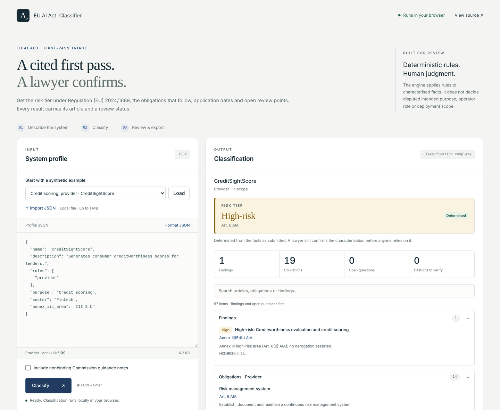

# Overview

The longer introduction to the classifier. The [README](../README.md) has install and the quick start; the [docs index](README.md) lists every other guide.

**Answer "Is our AI system high-risk under the EU AI Act?" with a cited, reviewable first pass instead of a one-word label.**

Find out which EU AI Act risk tier an AI system falls into, with every obligation cited to its article. Rules-based, offline, and built for a lawyer to confirm.

Built on Regulation (EU) 2024/1689 as consolidated on 27 July 2026. From the amending Regulation (EU) 2026/1744 it encodes the application dates, including the deferral of Chapter III, Sections 1 to 3 (Annex III 2027-12-02, Annex I 2028-08-02), and the new Art. 5(1)(ba) and (bb) prohibitions, which apply from 2026-12-02: the prohibited-practice screen returns a prohibited finding when a profile asserts one of them and quotes the Art. 5(1a) limits (and, for point (ba), Art. 5(1b)) without testing them. The [claim ledger](REGULATORY_CLAIM_LEDGER.md) lists the other amendments that are encoded; the rest have not been mapped. Not legal advice; the bundled example data is synthetic.

## Who it's for

- **General counsel, AI governance and compliance leads, and product counsel** doing a first-pass classification of an AI system before deeper legal review.
- **Lawyers who confirm the result** and need to check the reasoning: each obligation cites its Article, open questions name the Article and the fact to confirm, and generated work products are marked draft only.
- **Legal engineers** who need the same rules as a `--strict` gate in CI or an intake pipeline, as MCP tools or behind a local JSON API.
- **Developers** asking "am I high-risk?" before engaging counsel.

## Try it now

**[Open the live playground](https://sebastianfoerste.github.io/eu-ai-act-classifier/)**: no install, and nothing you paste leaves the page. The playground runs the same engine as the CLI.

> **If you don't code:** open the [playground](https://sebastianfoerste.github.io/eu-ai-act-classifier/) and pick one of the 18 synthetic examples, or see [Example output](sample-output.md#example-output). The point isn't the code; it's whether the legal work is structured, cited, reviewable, and testable.

## Human-authored legal judgment

AI tools assisted the implementation, but the parts that carry the value are human-authored: the Annex/Article mappings, the obligation set, and the prohibited-practice and review-status logic. The point of this repository is not code volume; it is showing how legal judgment can be made structured, testable, and reviewable. The rules are plain Python under `src/eu_ai_act_classifier/`, and the eval set is tested for drift.

## Honest limits

- This is a screening tool for supervised legal review. It does not produce legal advice, a conformity assessment or a binding regulatory conclusion. Generated work products require human legal review before use.
- Example data is synthetic.
- Guidance changes, and national implementation and supervisory practice may vary by Member State.
- The engine applies rules to characterised facts and does not decide disputed intended purpose, operator role or factual deployment scope.
- `requires_review`, draft artifacts and advisory overlays must be reviewed before reliance.

## Part of the EU regulation as code suite

Deterministic, review-gated tools for EU regulation, by [sebastianfoerste](https://github.com/sebastianfoerste):

- [awesome-eu-fintech-regulation](https://github.com/sebastianfoerste/awesome-eu-fintech-regulation): curated index of EU financial-regulation primary sources and tools
- [contract-review-eval-harness](https://github.com/sebastianfoerste/contract-review-eval-harness)
- [legal-function-operating-system](https://github.com/sebastianfoerste/legal-function-operating-system)
- **eu-ai-act-classifier** (this repo, [PyPI](https://pypi.org/project/eu-ai-act-classifier/))
- [micar-whitepaper-linter](https://github.com/sebastianfoerste/micar-whitepaper-linter): MiCAR whitepaper linter with pinpoint citations ([PyPI](https://pypi.org/project/micar-whitepaper-linter/))
- [eu-reg-mcp](https://github.com/sebastianfoerste/eu-reg-mcp) ([PyPI](https://pypi.org/project/eu-reg-mcp/))
- [micar-register-observatory](https://github.com/sebastianfoerste/micar-register-observatory)
