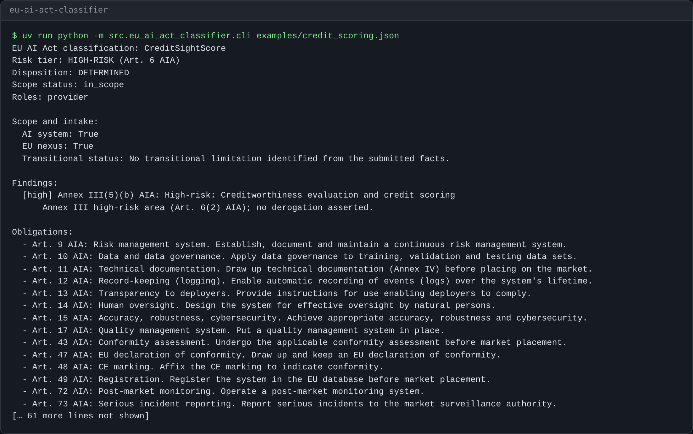

# Sample Output

This page shows the shape of the v0.2 output. The exact obligation list may grow
as the source registry and obligation graph are extended.

## Example Output

Real output of `uv run eu-ai-act-classify examples/social_scoring.json` (excerpt, run on this repo):

```text
EU AI Act classification: CitizenScore
Risk tier: PROHIBITED (Art. 5 AIA)
Disposition: DETERMINED
Scope status: in_scope
Roles: provider

Findings:
  [blocker] Art. 5(1)(c) AIA: Social scoring leading to detrimental or unfavourable treatment
      Prohibited practice under Art. 5 AIA. The system may not be placed on the market, put into service, or used.

Binding application timeline:
  2025-02-02: Chapters I-II, incl. Art. 5 (prohibited practices)
  ...
  2026-08-02: General application for provisions without a later specific date
  ...
  2027-12-02: Regulation (EU) 2026/1744: Chapter III Sections 1-3, Annex III high-risk systems
  2028-08-02: Regulation (EU) 2026/1744: Chapter III Sections 1-3, product-embedded high-risk systems

Source manifest:
  - Regulation (EU) 2024/1689: binding_level_1, retrieved 2026-10-18
  ...
```

A high-risk case (`examples/credit_scoring.json`) returns `Risk tier: HIGH-RISK (Art. 6 AIA)`, the finding `Annex III(5)(b) AIA: Creditworthiness evaluation and credit scoring`, and 14 cited obligations, for example:

```text
  - Art. 9 AIA: Risk management system. Establish, document and maintain a continuous risk management system.
  - Art. 10 AIA: Data and data governance. Apply data governance to training, validation and testing data sets.
  - Art. 11 AIA: Technical documentation. Draw up technical documentation (Annex IV) before placing on the market.
```

When a point is unsettled the disposition becomes `REQUIRES_REVIEW` (see `examples/ambiguous_use_case.json`) and the report says it needs lawyer review before reliance. The full committed sample is in [`examples/classification-packet.md`](../examples/classification-packet.md) and [`examples/classification-packet.json`](../examples/classification-packet.json).



*Actual output of `uv run python -m src.eu_ai_act_classifier.cli examples/credit_scoring.json` (equivalent to `uv run eu-ai-act-classify examples/credit_scoring.json`), rendered as an image by [`scripts/render_demo_png.py`](../scripts/render_demo_png.py). It shows the first 30 of 91 lines; the full output is in [`examples/classification-packet.md`](../examples/classification-packet.md).*

## CLI Report

Command:

```bash
eu-ai-act-classify examples/credit_scoring.json --advisory
```

Selected output:

```text
EU AI Act classification: CreditSightScore
Risk tier: HIGH-RISK (Art. 6 AIA)
Disposition: DETERMINED
Scope status: in_scope
Roles: provider

Scope and intake:
  AI system: True
  EU nexus: True
  Transitional status: No transitional limitation identified from the submitted facts.

Findings:
  [high] Annex III(5)(b) AIA: High-risk: Creditworthiness evaluation and credit scoring

Obligation graph:
  - high-risk.provider.16: Art. 16 AIA (provider), evidence: Provider compliance responsibility matrix., review: determined
  - high-risk.provider.43: Art. 43 AIA (provider), evidence: Conformity assessment file., review: review_required
      Literal reading, confirm with counsel: Art. 113, third paragraph, point (c) AIA defers only Chapter III, Sections 1, 2 and 3, so this Chapter III, Section 5 duty applies from 2026-08-02 (Art. 113, second paragraph). If it is read as following that deferral, 2027-12-02 applies.
  - high-risk.provider.72: Art. 72 AIA (provider), evidence: Post-market monitoring plan., review: review_required
      Literal reading, confirm with counsel: Art. 113, third paragraph, point (c) AIA defers only Chapter III, Sections 1, 2 and 3, so this Chapter IX duty applies from 2026-08-02 (Art. 113, second paragraph). If it is read as following that deferral, 2027-12-02 applies.

Binding application timeline:
  2025-02-02: Chapters I-II, incl. Art. 5 (prohibited practices)
  2025-08-02: Chapter V (general-purpose AI models)
  2025-08-02: Chapter III Section 4, Chapter VII, Chapter XII (except Art. 101) and Art. 78
  2026-07-27: Regulation (EU) 2026/1744: Arts. 102-110 AIA (amendments to other Union acts)
  2026-08-02: General application for provisions without a later specific date
  2026-12-02: Regulation (EU) 2026/1744: Art. 5(1)(ba) and (bb), Art. 5(1a) and (1b) AIA
  2026-12-02: Regulation (EU) 2026/1744: Art. 50(2) AIA for generative systems already on the market
  2027-08-02: Art. 111(3) AIA: general-purpose AI models already on the market before 2 August 2025
  2027-12-02: Regulation (EU) 2026/1744: Chapter III Sections 1-3, Annex III high-risk systems
  2028-08-02: Regulation (EU) 2026/1744: Chapter III Sections 1-3, product-embedded high-risk systems

Source manifest:
  - Regulation (EU) 2024/1689: binding_level_1, retrieved 2026-10-18
  - Regulation (EU) 2026/1744: binding_level_1, retrieved 2026-10-18
```

## Artifact Draft

Command:

```bash
eu-ai-act-classify examples/credit_scoring.json --artifact fria --artifacts-dir ./draft-artifacts
```

The generated Markdown draft includes:

1. Draft-only notice.
2. System, risk tier, disposition and scope status.
3. Review status.
4. Checklist.
5. Relevant obligation graph items.
6. Open questions.
7. Source manifest.

## GPAI JSON

Command:

```bash
eu-ai-act-classify examples/foundation_model_systemic.json --json
```

Selected fields:

```json
{
  "risk_tier": "minimal_risk",
  "is_gpai": true,
  "gpai_systemic": true,
  "obligation_graph": [
    {
      "obligation_id": "gpai.provider.53.a",
      "article": "Art. 53(1)(a) AIA",
      "actor": "gpai_provider",
      "evidence_artifact": "GPAI model documentation checklist."
    }
  ]
}
```
